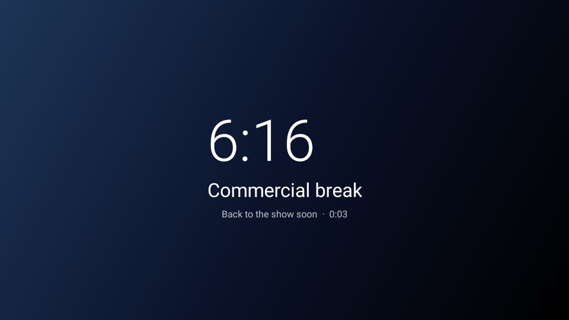
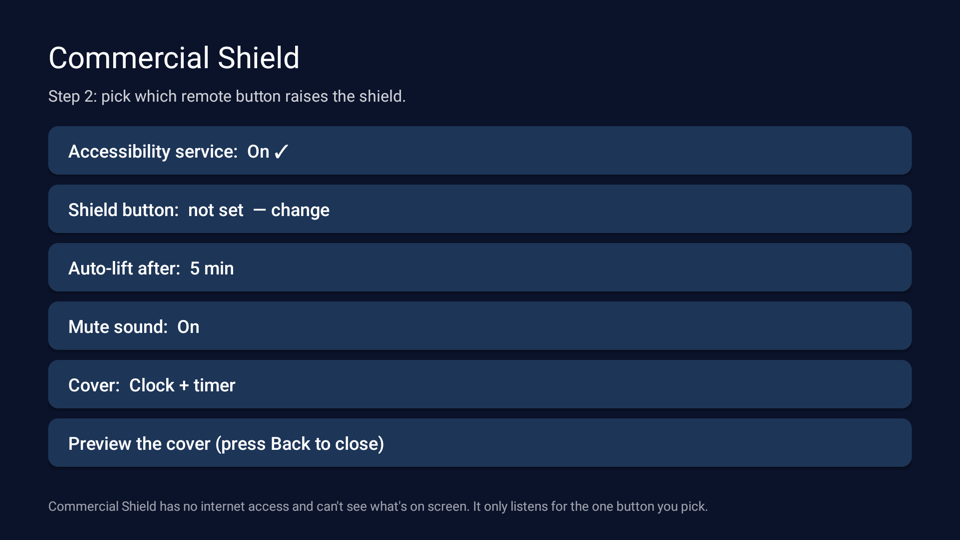

# 🛡️ Commercial Shield

**One button on your TV remote hides the commercials.**

Press it when an ad comes on: the screen is covered and the sound goes off. Press it again when the show is back.

I built this because live sports are full of ads I don't want my kids to see, like horror-movie trailers in the middle of a baseball game. Streaming apps splice live-sport ads right into the video, so ad blockers can't touch them and paying for "no ads" doesn't remove them. Commercial Shield doesn't try to block anything. It just gives you a one-press way to cover the screen.

<p align="center">
  
</p>

- 🎯 **One button.** You pick any spare button on your remote, like an app shortcut you never use or a color button.
- 🙈 **Covers everything.** It works over any app: Max, Peacock, YouTube TV, Fox One, ESPN, Paramount+, Hulu Live, Sling, the TV tuner, anything.
- 🔇 **Mutes the sound,** and restores it afterwards. If the sound was already muted before the break, it stays muted.
- ⏱️ **Break timer** so you can guess when the game's back. Most live-sports breaks run 2 to 2½ minutes.
- 🔙 **Back works too,** and the cover lifts itself after 5 minutes (adjustable) so the TV never gets stuck.
- 🔒 **No internet permission, no tracking, no accounts.** It can't read your screen. See [Privacy & security](#privacy--security).

---

## Contents

- [Will it work on my TV?](#will-it-work-on-my-tv)
- [Install: Option A, with a computer (easiest to get right)](#option-a-install-with-a-computer)
- [Install: Option B, with no computer (Downloader app)](#option-b-install-with-no-computer)
- [Set it up on the TV](#set-it-up-on-the-tv)
- [Choosing a good shield button](#choosing-a-good-shield-button)
- [Using it](#using-it)
- [Troubleshooting](#troubleshooting)
- [Privacy & security](#privacy--security)
- [Uninstall](#uninstall)
- [Build from source](#build-from-source)
- [How it works](#how-it-works)
- [FAQ](#faq)

---

## Will it work on my TV?

Commercial Shield is an Android app, so it needs a TV or streaming box running **Android TV, Google TV or Fire TV**.

| Device | Status |
|---|---|
| Hisense Google TV (Android 12) | ✅ Tested |
| Other Google TV / Android TV TVs (Sony, TCL, Philips, Sharp…) | Should work, but not tested yet |
| Chromecast with Google TV, onn 4K box, NVIDIA Shield | Should work, but not tested yet |
| Amazon Fire TV Stick / Cube / Fire TV TVs | Should work, but not tested yet |
| Roku, Samsung (Tizen), LG (webOS), Apple TV | ❌ Not Android. Apps like this aren't possible on these. |

Got it running on something not listed? Please [open an issue](../../issues) with your device, and add whether mute worked. That helps everyone.

> **Requirement:** Android 7.0 or newer. Practically every Android TV from the last several years qualifies.

---

## Option A: Install with a computer

Best if you have a Mac, Windows or Linux computer on the same Wi-Fi as the TV.

**1. Turn on developer mode on the TV** (one time)

- **Google TV:** Settings → **System** → **About** → highlight **Android TV OS build** and press OK **7 times** until it says *"You are now a developer."*
- **Older Android TV:** Settings → **Device Preferences** → **About** → **Build**, OK 7 times.
- **Fire TV:** Settings → **My Fire TV** → **About** → press OK on your device name **7 times**.

Then go back one level, open **Developer options**, and turn on **USB debugging** (on Fire TV it's called **ADB debugging**).

**2. Find the TV's IP address:** Settings → Network / Wi-Fi → your network. It looks like `192.168.1.42`.

**3. Install `adb`** (Android's official connection tool):

- macOS: `brew install android-platform-tools`
- Windows: `winget install Google.PlatformTools`
- Linux: `sudo apt install adb`

**4. Download and install Commercial Shield:**

```bash
git clone https://github.com/stormr-doteth/commercial-shield.git
cd commercial-shield
# put commercial-shield.apk from the Releases page into this folder's build/ directory, or build it yourself (see below)
./install.sh 192.168.1.42
```

A box will appear on the TV asking **"Allow USB debugging?"** Tick *Always allow from this computer* and choose **Allow**.

The script installs the app, turns on its accessibility service, and opens the setup screen. Skip ahead to [Set it up on the TV](#set-it-up-on-the-tv).

<details>
<summary>Prefer to type the commands yourself? (Windows without bash, etc.)</summary>

```bash
adb connect 192.168.1.42:5555
adb install -r commercial-shield.apk
adb shell appops set io.github.stormrdoteth.commercialshield ACCESS_RESTRICTED_SETTINGS allow
```
Then turn the service on from the TV, as in [Set it up on the TV](#set-it-up-on-the-tv) step 1.

> ⚠️ Don't use `adb shell settings put secure enabled_accessibility_services …` unless you include the services already in that list (`adb shell settings get secure enabled_accessibility_services` shows them). Overwriting it turns off other accessibility apps such as Projectivy Launcher. `install.sh` handles this for you.
</details>

---

## Option B: Install with no computer

1. On the TV, install **Downloader by AFTVnews** from the Google Play Store (or the Amazon Appstore on Fire TV).
2. Allow it to install apps:
   - **Google TV / Android TV:** Settings → **Apps** → **Security & restrictions** → **Unknown sources** → turn on **Downloader**.
   - **Fire TV:** Settings → **My Fire TV** → **Developer options** → **Install unknown apps** → **Downloader** → On. (If you don't see Developer options, see Option A step 1.)
3. Open Downloader and enter the APK link from the [latest release](../../releases/latest).
   It's the link to `commercial-shield.apk`.
4. Choose **Install**, then **Open**.

---

## Set it up on the TV

Open **Commercial Shield** from your apps. It's a single screen you drive with the remote:

<p align="center">
  
</p>

**1. Turn on the service** (skip if you used `install.sh`; it already shows **On ✓**)

Choose **Accessibility service**. This opens the TV's Accessibility settings. Find **Commercial Shield**, turn it **On**, and confirm. Then press Back to return.

> **"Restricted setting" message on Android 13+?** Android blocks accessibility for apps that didn't come from the Play Store until you allow it. Go to Settings → **Apps** → **Commercial Shield** → ⋮ (or scroll down) → **Allow restricted settings**, then try again. If your TV has no such option, use the `appops` command from Option A.

**2. Pick your shield button**

Choose **Shield button → change**, then press the remote button you want to use. Its name appears on the screen. Done.

**3. Optional tweaks**

| Setting | What it does |
|---|---|
| **Auto-lift after** | Cover lifts itself after 2 / 3 / **5** / 10 minutes, or never. |
| **Mute sound** | Turn off if you only want to hide the picture. |
| **Cover** | **Clock + timer** (default) or **Plain black**. |
| **Preview the cover** | Try it out. Press Back to close. |

---

## Choosing a good shield button

Pick a button you don't need for anything else. Good choices:

- **An app shortcut you never use.** Many remotes have YouTube, Prime Video, Disney+ or Tubi buttons.
- **A color button** (red/green/yellow/blue), if your remote has them.
- **A button like "Bookmark", "Guide" or "Info"** you never use.

The arrows, OK, Back, Home, Power and volume buttons can't be picked, so your remote always keeps working.

> **If pressing your button raises the shield *and* opens its app,** your TV's firmware is also handling that button. Pick a different one.
>
> **If nothing happens when you press a button during "Shield button → change",** that button is handled entirely by the TV's hardware and Android never sees it. Pick a different one.

---

## Using it

| You want to… | Press |
|---|---|
| Hide a commercial | **Your shield button** |
| Go back to the show | **Your shield button** again, or **Back** |
| Forget about it | Nothing. It lifts itself after 5 minutes. |

Tips:

- The ad has already started by the time you react, so keep the remote in hand during games.
- The break timer helps you guess. US live-sports breaks are usually 2:00 to 2:30, and the postseason runs a bit longer.
- It works in every app, so it's handy for any live TV, not just sports.

---

## Troubleshooting

**The cover appears but I can still hear the ad.**
Some soundbars and receivers connected by HDMI ARC/eARC or optical control their own volume. The TV's mute then doesn't reach them. Use your soundbar remote's mute as well, or set **Cover** to Plain black and turn the volume down. If you work out a fix for your setup, please share it in an issue.

**Pressing the button does nothing.**
- Open Commercial Shield and check that the service shows **On ✓**. Some TVs turn accessibility services off after an update or when memory runs low.
- Re-pick the button. Some remotes send different codes after re-pairing.
- If the setup screen never reacts to your button, Android isn't receiving that button; choose another.

**The service keeps turning itself off.**
Some TVs aggressively close background apps. Open the TV's Settings → Apps → Commercial Shield and make sure it isn't restricted or "optimized" for battery or memory.

**Other accessibility apps stopped working after I installed it.**
Something overwrote the enabled-services list. In TV Settings → Accessibility, turn the other app back on. Commercial Shield's `install.sh` never removes other services.

**I want to change my settings.**
Open the Commercial Shield app any time.

---

## Privacy & security

You're giving an app an accessibility permission, so here is exactly what it can and can't do:

- **It can't use the internet.** The app doesn't request Android's `INTERNET` permission, so the system won't let it send data anywhere. Check it yourself: TV Settings → Apps → Commercial Shield → Permissions, or `aapt dump permissions commercial-shield.apk`.
- **It can't read your screen.** The service is configured with `canRetrieveWindowContent="false"` and doesn't subscribe to screen events ([`res/xml/shield_service.xml`](res/xml/shield_service.xml)).
- **It only reacts to one button.** It receives remote key presses (that's what lets it notice your shield button) and immediately passes every other key through untouched. Nothing is logged or stored except your settings.
- **It doesn't touch your streams.** It never blocks, skips, alters or records anything. It just draws a cover on top and mutes the volume, which is the same as you pressing mute and putting a towel over the TV.
- **About 500 lines of code,** all in [`src/`](src/). Short enough to read in one sitting.

**Verifying a download:** release APKs are built by GitHub Actions directly from the tagged source ([workflow](.github/workflows/build.yml)), and each release lists the APK's SHA-256 checksum. Compare it with:

```bash
shasum -a 256 commercial-shield.apk     # macOS / Linux
certutil -hashfile commercial-shield.apk SHA256   # Windows
```

Only download Commercial Shield from this repository's [Releases page](../../releases). Anything else could be modified.

---

## Uninstall

TV Settings → **Apps** → **Commercial Shield** → **Uninstall**.
Or: `adb uninstall io.github.stormrdoteth.commercialshield`

This leaves nothing behind.

---

## Build from source

Requirements: JDK 17+ and the Android SDK command-line tools with `platforms;android-31` and `build-tools;34.0.0`. Gradle isn't needed.

```bash
# macOS example
brew install openjdk@17
brew install --cask android-commandlinetools
sdkmanager --sdk_root="$HOME/Library/Android/sdk" "platforms;android-31" "build-tools;34.0.0"

./build.sh                      # → build/commercial-shield.apk (signed with a local debug key)
./install.sh <tv-ip>            # install on your TV
```

`build.sh` honors `ANDROID_HOME`, `BUILD_TOOLS`, `PLATFORM`, and `KEYSTORE` / `KEYSTORE_PASS` / `KEY_ALIAS` / `KEY_PASS` for release signing.

### Project layout

```
AndroidManifest.xml          app + service declaration (note: no INTERNET permission)
res/xml/shield_service.xml   accessibility config: key events only, no screen content
src/…/ShieldService.java     listens for the shield button, shows/hides the cover, mutes
src/…/CoverView.java         the cover: clock, "Commercial break", timer, burn-in drift
src/…/SetupActivity.java     the on-TV setup screen
src/…/Prefs.java             settings + which buttons are off-limits
build.sh / install.sh        build and install without Gradle
```

---

## How it works

Android lets accessibility services see remote key presses *before* apps do. That's how tools like button remappers work. Commercial Shield's service watches for the one key code you picked:

1. **Key pressed:** it adds a full-screen `TYPE_ACCESSIBILITY_OVERLAY` window. That window type can sit above any app, including video players, without the "display over other apps" permission.
2. It mutes `STREAM_MUSIC` with `AudioManager`, but only if the sound wasn't already muted.
3. **Key pressed again, Back, or the timer runs out:** it removes the window and unmutes.

Everything else, like the arrows, OK and every other button, is returned untouched, so the app underneath keeps working normally.

---

## FAQ

**Does this block ads?**
No. The ad still plays underneath. Nothing is blocked or skipped. Your screen is just covered while it runs.

**Can't it detect commercials automatically?**
Not reliably. Streaming apps stitch ads directly into the video, and Android doesn't let other apps see protected video, so there's no signal to detect. A manual button is honest and works everywhere. If you have a solid idea for automatic detection, open an issue.

**Is this allowed?**
It's the same as pressing mute and covering the screen. It doesn't modify, block or record any app or stream.

**Will it slow my TV down?**
No. It does nothing until you press the button, and the cover is a few lines of text.

**Can I use a photo or my team's logo as the cover?**
Not yet. It's a great first contribution.

---

## Contributing

Bug reports, device test reports and pull requests are welcome. Please keep the core promise: **no internet permission and no screen reading.**

## License

[MIT](LICENSE). Not affiliated with any TV maker, streaming service or sports league.
